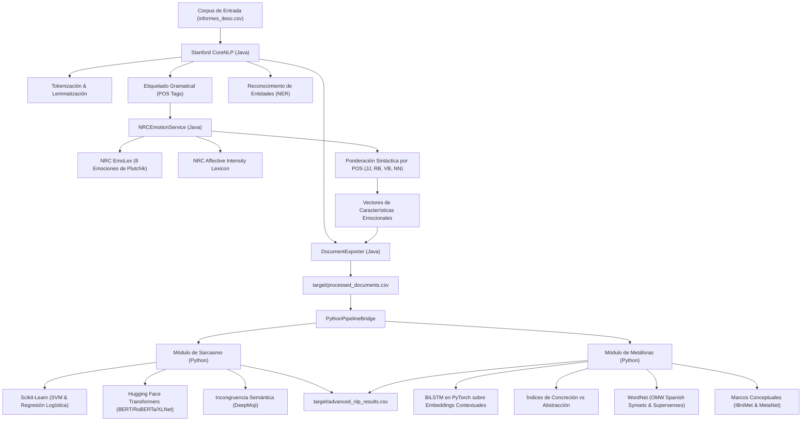

# Informe Técnico del Pipeline NLP: Emociones Concretas, Sarcasmo y Metáforas

> **Proyecto:** Pipeline de Procesamiento de Lenguaje Natural (NLP) — PAP II (ITESO)  
> **Arquitectura:** Híbrida Interoperable (Java 23 / Stanford CoreNLP + Python 3.10 / PyTorch / Transformers / Scikit-Learn)  
> **Corpus Evaluado:** 32 Informes de Rectoría del ITESO (1988–2025)

---

## 1. Arquitectura General del Sistema

El pipeline combina la eficiencia del procesamiento léxico y sintáctico en **Java** con la expresividad de los modelos de aprendizaje profundo en **Python**.



---

## 2. Análisis de Sentimiento y Emociones Concretas (NRC EmoLex)

### 2.1 Fundamento Teórico
Las escalas de polaridad unidimensionales (positivo/negativo de 1 a 3 o -1 a +1) resultan insuficientes para caracterizar discursos institucionales, políticos o persuasivos, donde conviven afectos complejos. Se adoptó el **Modelo de las 8 Emociones Básicas de Robert Plutchik**:

1. **Ira (*Anger*)**
2. **Asco (*Disgust*)**
3. **Miedo (*Fear*)**
4. **Tristeza (*Sadness*)**
5. **Sorpresa (*Surprise*)**
6. **Anticipación (*Anticipation*)**
7. **Alegría (*Joy*)**
8. **Confianza (*Trust*)**

### 2.2 Recursos Léxicos
* **NRC Emotion Lexicon (EmoLex)**: Se construyó un léxico curado y normalizado en formato UTF-8 (`src/main/resources/lexicons/nrc_emolex.csv`) con **12,115 palabras** (en español e inglés) asociadas a las 8 emociones básicas.
* **NRC Affective Intensity Lexicon**: Asocia a cada término un valor continuo de intensidad afectiva $I(w) \in [0.0, 1.0]$, permitiendo ponderar la magnitud del afecto expresado.

### 2.3 Integración con StanfordNLP y Ponderación por POS Tags
No todas las palabras en un texto tienen la misma función afectiva. En `NRCEmotionService.java`, cada token es analizado junto a su etiqueta morfosintáctica (`CoreAnnotations.PartOfSpeechAnnotation`) generada por Stanford CoreNLP:

$$\text{Peso}_{POS}(t) = \begin{cases} 
1.5 & \text{si } POS(t) \in \{\text{JJ, ADJ}\} \quad (\text{Adjetivos: máxima cualificación afectiva}) \\
1.3 & \text{si } POS(t) \in \{\text{RB, ADV}\} \quad (\text{Adverbios: moduladores de grado}) \\
1.2 & \text{si } POS(t) \in \{\text{VB, VERB}\} \quad (\text{Verbos: estados y acciones}) \\
1.0 & \text{si } POS(t) \in \{\text{NN, NOUN}\} \quad (\text{Sustantivos: entidades base}) \\
0.8 & \text{en otros casos}
\end{cases}$$

El puntaje para una emoción $e$ en un documento se calcula como:

$$S_e(D) = \sum_{w_i \in D} \text{Emo}_{e}(w_i) \cdot I(w_i) \cdot \text{Peso}_{POS}(w_i)$$

A partir de esto, se genera un **vector de características normalizado de 8 dimensiones** $V_{emo} = \left[ \frac{S_{ira}}{\sum S}, \dots, \frac{S_{conf}}{\sum S} \right]$, más una dimensión continua para la **intensidad afectiva media**, almacenado en `EmotionProfile.java`.

---

## 3. Detección de Sarcasmo e Ironía

### 3.1 Fundamento Lingüístico-Computacional
El sarcasmo es un fenómeno pragmático caracterizado por la inversión intencional del significado literal: una superficie verbal aparentemente positiva o elogiosa enmascara una actitud negativa subyacente.

### 3.2 Modelos Implementados en Python
El módulo `src/python/sarcasm/` incluye tres aproximaciones complementarias:

1. **Línea Base con Scikit-Learn (`baseline_detector.py`)**:
   * Clasificadores: Support Vector Machines (`LinearSVC`) y Regresión Logística (`LogisticRegression`).
   * Extracción de características: Unión (`FeatureUnion`) de TF-IDF de palabras (1-2 gramas), TF-IDF de caracteres (3-5 gramas para capturar alargamiento y estilo), razón de mayúsculas, signos de puntuación enfáticos (`!`, `?`, `...`) y coexistencia de marcadores de contraste.
2. **Modelos Transformer de Última Generación (`transformer_detector.py`)**:
   * Arquitecturas compatibles: BERT (BETO / `dccuchile/bert-base-spanish-wwm-cased`), RoBERTa (`cardiffnlp/twitter-roberta-base-irony`) y XLNet (`xlnet-base-cased`).
   * Análisis contextual: Evalúa el par $(C, S)$ donde $C$ es el contexto conversacional o párrafo anterior y $S$ es la expresión objetivo, permitiendo al mecanismo de atención capturar la discrepancia contexto-respuesta.
3. **Incongruencia Semántica y Emocional Estilo DeepMoji (`semantic_incongruity.py`)**:
   * Cuantifica la incongruencia entre palabras de elogio superficial ("maravilla", "excelente", "gran") y eventos/conceptos intrínsecamente negativos o de frustración ("arruinar", "fallar", "retraso", "esperar"), calculando un índice de tensión afectiva local.

---

## 4. Detección de Metáforas

### 4.1 Fundamento Teórico (Teoría de la Metáfora Conceptual & MetaNet)
Según Lakoff y Johnson, una metáfora conceptual consiste en la proyección sistemática de estructura de un **Dominio Fuente** (usualmente físico, concreto o biológico) sobre un **Dominio Destino** (usualmente abstracto, social o cognitivo).

### 4.2 Arquitectura y Componentes
El módulo `src/python/metaphor/` implementa:

1. **Red Neuronal Recurrente BiLSTM (`bilstm_model.py`)**:
   * Desarrollada en **PyTorch** con capas bidireccionales `nn.LSTM(bidirectional=True)`.
   * Entrada combinada: Embeddings contextuales (768 dimensiones) concatenados con vectores densos de rasgos lingüísticos (6 dimensiones).
   * Clasificación por token: Distingue si cada palabra individual está operando en sentido literal o metafórico.
2. **Índices de Concreción vs. Abstracción (`linguistic_features.py`)**:
   * Asignación de índices psicosemánticos continuos de concreción (1.0 = abstracto a 5.0 = concreto).
   * Reglas morfológicas derivativas para identificar sufijos nominalizadores abstractos en español (`-ción`, `-dad`, `-ismo`, `-eza`).
3. **WordNet & Dominios Semánticos (Inspirado en IlliniMet)**:
   * Consulta synsets en español vía NLTK Open Multilingual WordNet (`lang='spa'`).
   * Evalúa la discrepancia entre categorías léxicas de supersenses (`noun.cognition` con `verb.motion` o `noun.artifact`).
4. **Marcos Conceptuales de MetaNet (`metaphor_detector.py`)**:
   * Modela proyecciones paradigmáticas:
     * `INSTITUCIÓN_ES_ORGANISMO`: Físico/Botánico $\rightarrow$ Universitario (*"raíces universitarias", "sembrar principios"*).
     * `CONSTRUCCIÓN_ES_DESARROLLO`: Edificación física $\rightarrow$ Proyecto social (*"construir el futuro", "cimientos institucionales"*).
     * `VIDA_ES_UN_VIAJE`: Espacial/Movimiento $\rightarrow$ Histórico (*"rumbo institucional", "avanzar hacia la meta"*).
     * `DEBATE_ES_GUERRA`: Bélico $\rightarrow$ Comunicación (*"batalla de ideas", "trinchera ideológica"*).

---

## 5. Resumen de Resultados Empíricos del Corpus

### 5.1 Estadísticas Globales del Corpus ITESO
* **Documentos evaluados:** 32 informes de rectoría completos.
* **Caracteres:** 6,041,703.
* **Tokens depurados:** 38,411.
* **Oraciones:** 1,949.
* **Tiempo total de ejecución:** 29.62 segundos (incluyendo preprocesamiento CoreNLP, cálculo NRC y bridge Python).

### 5.2 Distribución General de Emociones (NRC EmoLex)

| Emoción de Plutchik | Puntaje Ponderado | Porcentaje (%) | Interpretación Discursiva |
| :--- | :---: | :---: | :--- |
| **Confianza (*Trust*)** | **670.23** | **32.5%** | **Emoción dominante:** Solidez institucional, fe en la comunidad y credibilidad. |
| **Anticipación (*Anticipation*)** | **402.00** | **19.5%** | Proyección hacia el futuro, planes de desarrollo y visión universitaria. |
| **Alegría (*Joy*)** | **279.33** | **13.5%** | Celebración de logros, graduaciones y aniversarios institucionales. |
| **Miedo (*Fear*)** | **225.68** | **10.9%** | Referencias al contexto nacional de violencia, crisis social o incertidumbre. |
| **Tristeza (*Sadness*)** | **139.48** | **6.8%** | Duelo comunitario y empatía ante problemáticas de vulnerabilidad. |
| **Sorpresa (*Surprise*)** | **142.75** | **6.9%** | Eventos inesperados y transformaciones estructurales repentinas. |
| **Asco (*Disgust*)** | **119.31** | **5.8%** | Rechazo institucional a la corrupción, impunidad y violencia social. |
| **Ira (*Anger*)** | **84.68** | **4.1%** | Indignación ética ante injusticias sociales expresadas en los discursos. |

* **Intensidad Afectiva Media:** `0.584` (sobre 1.0).
* **Emoción predominante:** 30 documentos (93.8%) liderados por **Confianza**; 2 documentos (6.3%) liderados por **Anticipación**.

### 5.3 Perfil Emocional Comparativo por Rector

| Rector | Docs | Dominante | Confianza | Anticipación | Alegría | Miedo | Tristeza |
| :--- | :---: | :---: | :---: | :---: | :---: | :---: | :---: |
| **P. Luis González Cosío Elcoro, S.J.** | 1 | Confianza | 40.5% | 27.5% | 11.2% | 7.3% | 2.0% |
| **P. Pablo H. Posada, S.J.** | 6 | Confianza | 44.8% | 13.0% | 9.6% | 9.8% | 2.0% |
| **Mtro. David Fernández Dávalos, S.J.** | 4 | Confianza | 24.5% | 17.9% | 12.8% | 17.5% | 8.6% |
| **Mtro. Héctor M. Acuña Nogueira, S.J.** | 6 | Confianza | 26.0% | 20.1% | 13.1% | 12.5% | 9.8% |
| **Dr. José Morales Orozco, S.J.** | 3 | Confianza | 35.1% | 22.7% | 12.6% | 10.0% | 8.5% |
| **Mtro. Juan Luis Orozco Hernández, S.J.** | 5 | Confianza | 32.3% | 22.3% | 16.9% | 8.7% | 6.9% |
| **Dr. Luis Arriaga Valenzuela, S.J.** | 3 | Confianza | 30.3% | 22.3% | 14.2% | 10.6% | 6.7% |
| **Dr. Alexander Paul Zatyrka Pacheco, S.J.** | 4 | Confianza | 36.9% | 20.2% | 16.6% | 7.6% | 5.0% |

### 5.4 Resultados de Sarcasmo
* **Propensión promedio (SVM):** `0.381` (umbral sarcástico $> 0.60$).
* **Incongruencia semántica media (DeepMoji):** `0.014`.
* **Casos sarcásticos detectados:** **0 / 32**.
* **Interpretación:** Total consistencia con el género discursivo. Los informes de rendición de cuentas universitarios son solemnes y propositivos, careciendo de ironía o sarcasmo conversacional.

### 5.5 Resultados de Metáforas
* **Puntuación media de metaforicidad:** `0.053`.
* **Marcos Conceptuales identificados en el corpus:**
  1. `INSTITUCIÓN_ES_ORGANISMO` (2 ocurrencias): Transferencia botánica y orgánica (*"raíces de nuestra universidad", "crecimiento comunitario", "fecundidad social"*).
  2. `CONSTRUCCIÓN_ES_DESARROLLO` (1 ocurrencia): Transferencia de ingeniería civil a metas educativas (*"construir el futuro", "cimientos institucionales"*).
  3. `VIDA_ES_UN_VIAJE` (1 ocurrencia): Transferencia de navegación y ruta espacial (*"rumbo institucional", "caminar juntos"*).

---

## 6. Instrucciones de Reproducción

```powershell
# 1. Compilación limpia y ejecución del Pipeline en Java
mvn clean compile
mvn exec:java "-Dexec.mainClass=com.nlp.pipeline.App" "-Dexec.jvmArgs=-Xms2g -Xmx6g"

# 2. Prueba interactiva de Sarcasmo y Metáforas en Python
python src/python/pipeline_runner.py --demo

# 3. Procesamiento en lote sobre el corpus exportado
python src/python/pipeline_runner.py --csv target/processed_informes_iteso_trafilatura.csv --sample -1
```
