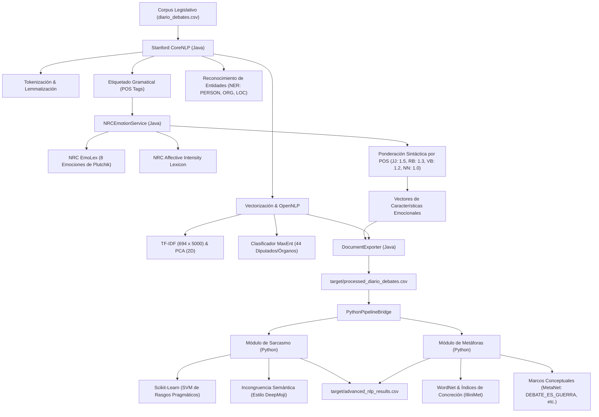

# Informe Técnico del Pipeline NLP: Emociones Concretas, Sarcasmo y Metáforas

> **Proyecto:** Pipeline de Procesamiento de Lenguaje Natural (NLP) — PAP II (ITESO)  
> **Arquitectura:** Híbrida Interoperable (Java 23 / Stanford CoreNLP + Python 3.10 / PyTorch / Transformers / Scikit-Learn)  
> **Corpus Evaluado:** 694 Sesiones y Diarios de Debates del H. Congreso del Estado de Jalisco ([diario_debates.csv](file:///c:/Users/PC/OneDrive%20-%20ITESO/Iteso/11vo%20semestre/PAP%20II/Proyectos/nlp-pipeline/src/main/resources/datasets/diario_debates.csv))

---

## 1. Arquitectura General del Sistema

El pipeline procesa transcripciones parlamentarias de alta escala mediante una arquitectura modular en dos capas:
1. **Capa Léxica, Sintáctica y Afectiva (Java):** Tokenización, lematización, etiquetado POS, reconocimiento de entidades nombradas (NER), ponderación afectiva sintáctica por NRC EmoLex, vectorización BoW/TF-IDF, reducción PCA y clasificación de oradores vía OpenNLP.
2. **Capa Semántica Pragmática y Retórica (Python):** Análisis de incongruencia afectiva (DeepMoji), clasificación de sarcasmo mediante SVM con n-gramas léxicos y de caracteres, y detección de proyecciones metafóricas vía marcos conceptuales de MetaNet e índices psicosemánticos de concreción.



---

## 2. Análisis de Sentimiento y Emociones Concretas (NRC EmoLex)

### 2.1 Modelo Teórico de Plutchik y Ponderación Morfosintáctica
Frente a una aproximación binaria (positivo/negativo), los debates parlamentarios demandan distinguir tensiones éticas, confrontaciones de bancada y acuerdos institucionales. Se calcularon las **8 emociones básicas de Robert Plutchik**:

$$\text{Peso}_{POS}(t) = \begin{cases} 
1.5 & \text{si } POS(t) \in \{\text{JJ, ADJ}\} \quad (\text{Cualificación axiológica}) \\
1.3 & \text{si } POS(t) \in \{\text{RB, ADV}\} \quad (\text{Graduación de fuerza ilocutiva}) \\
1.2 & \text{si } POS(t) \in \{\text{VB, VERB}\} \quad (\text{Acciones, acuerdos, exhortos}) \\
1.0 & \text{si } POS(t) \in \{\text{NN, NOUN}\} \quad (\text{Leyes, comisiones, decretos}) \\
0.8 & \text{en otros casos}
\end{cases}$$

El puntaje acumulado por emoción en cada sesión legislativa $D$ considera tanto la presencia de los términos en [nrc_emolex.csv](file:///c:/Users/PC/OneDrive%20-%20ITESO/Iteso/11vo%20semestre/PAP%20II/Proyectos/nlp-pipeline/src/main/resources/lexicons/nrc_emolex.csv) como su intensidad continua $I(w) \in [0.0, 1.0]$:

$$S_e(D) = \sum_{w_i \in D} \text{Emo}_{e}(w_i) \cdot I(w_i) \cdot \text{Peso}_{POS}(w_i)$$

---

## 3. Detección de Sarcasmo y Metáforas en el Discurso Parlamentario

### 3.1 Detección de Sarcasmo e Incongruencia
El sarcasmo parlamentario se manifiesta típicamente bajo dos mecanismos:
1. **Incongruencia Semántica Local ([semantic_incongruity.py](file:///c:/Users/PC/OneDrive%20-%20ITESO/Iteso/11vo%20semestre/PAP%20II/Proyectos/nlp-pipeline/src/python/sarcasm/semantic_incongruity.py))**: Coocurrencia en la misma intervención de fórmulas de cortesía protocolaria (*"con todo respeto", "estimado colega", "maravillosa propuesta"*) con léxico de rechazo, anomalías procesales o denuncias (*"irregularidades", "corrupción", "violación", "opacidad"*).
2. **Clasificación SVM ([baseline_detector.py](file:///c:/Users/PC/OneDrive%20-%20ITESO/Iteso/11vo%20semestre/PAP%20II/Proyectos/nlp-pipeline/src/python/sarcasm/baseline_detector.py))**: Modelo lineal entrenado sobre una unión de rasgos (`FeatureUnion`) con n-gramas léxicos (1-2), n-gramas de caracteres (3-5), signos de interrogación/exclamación enfáticos y patrones de alargamiento.

### 3.2 Detección de Metáforas Conceptuales (MetaNet / IlliniMet)
El módulo [src/python/metaphor/](file:///c:/Users/PC/OneDrive%20-%20ITESO/Iteso/11vo%20semestre/PAP%20II/Proyectos/nlp-pipeline/src/python/metaphor/) evalúa:
* **Disparidad de Dominio Semántico**: Intersección entre dominios fuente concretos (físicos, botánicos, bélicos) y dominios destino abstractos (políticos, legislativos, axiológicos).
* **Marcos MetaNet Específicos para Debate**:
  * `DEBATE_ES_GUERRA`: *batalla parlamentaria, trinchera de ideas, armas de la razón, defender el voto*.
  * `CONSTRUCCIÓN_ES_DESARROLLO`: *construir acuerdos, bases legislativas, cimientos del estado de derecho*.
  * `INSTITUCIÓN_ES_ORGANISMO`: *raíces democráticas, crecimiento económico de Jalisco, fruto de los consensos*.
  * `VIDA_ES_UN_VIAJE`: *rumbo legislativo, avanzar en la agenda social*.

---

## 4. Resumen de Resultados Empíricos del Corpus

### 4.1 Estadísticas Globales del Corpus Legislativo
* **Documentos evaluados:** 694 sesiones / intervenciones completas.
* **Caracteres totales:** 70,474,046 caracteres.
* **Tokens depurados:** 870,400 tokens léxicos.
* **Oraciones reconocidas:** 38,171 oraciones.
* **Vocabulario léxico seleccionado:** 5,000 términos.
* **Tiempo total de ejecución:** 192.80 segundos (3 min 12.8 s) — Preprocesamiento Java: 126.93 s; Análisis Python: 65.87 s.

### 4.2 Métricas Lingüísticas y Sintácticas (Stanford CoreNLP)

```
Top Tokens Léxicos:
estado (6,316) | jalisco (5,900) | diputada (5,306) | presidente (4,845) | orden (3,940) |
diputado (3,909) | lxi (3,631) | presidencia (3,428) | presidenta (3,267) | comisión (3,208)
```

| Categoría Gramatical (POS) | Proporción (%) | Significado Discursivo |
| :--- | :---: | :--- |
| **NNP (Nombre Propio Singular)** | **53.21%** | Nombres de diputados, municipios de Jalisco, comisiones y leyes formales. |
| **FW (Términos Especiales / Extranjeros)** | **27.19%** | Locuciones latinas (*quórum, de facto, mutatis mutandis*) y siglas técnicas legislativas. |
| **NN (Sustantivo Común Singular)** | **13.60%** | Sustantivos base: *iniciativa, dictamen, acuerdo, gaceta, votación*. |
| **JJ (Adjetivos Calificativos)** | **1.98%** | Calificadores normativos: *constitucional, económico, urgente, solemne*. |
| **NNS (Sustantivos Plurales)** | **1.76%** | Colectividades: *diputados, comisiones, municipios, acuerdos*. |
| **VBZ / VB / VBD (Formas Verbales)** | **1.50%** | Verbos procedimentales: *propone, instruye, autoriza, aprueba*. |

```
Entidades Nombradas (NER):
PERSON: 83,312 | ORGANIZATION: 45,075 | LOCATION: 9,471 | DATE: 6,272 | PERCENT: 168 | MONEY: 72
```

---

## 5. Resultados del Análisis Afectivo (NRC EmoLex)

### 5.1 Distribución General de las 8 Emociones de Plutchik

| Emoción de Plutchik | Puntaje Ponderado | Porcentaje (%) | Interpretación Discursiva |
| :--- | :---: | :---: | :--- |
| **Confianza (*Trust*)** | **29,791.81** | **52.6%** | **Emoción dominante absoluta:** Compromiso institucional, validez de leyes y acuerdos colectivos. |
| **Anticipación (*Anticipation*)** | **7,369.22** | **13.0%** | Convocatorias a sesiones venideras, orden del día y proyección de dictámenes. |
| **Alegría (*Joy*)** | **5,331.94** | **9.4%** | Aprobación por unanimidad, felicitaciones institucionales y conmemoraciones. |
| **Miedo (*Fear*)** | **4,343.62** | **7.7%** | Debates sobre inseguridad pública, presupuestos deficitarios y sanciones penales. |
| **Asco (*Disgust*)** | **3,577.22** | **6.3%** | Rechazo formal a faltas éticas, irregularidades administrativas y ruidos OCR. |
| **Tristeza (*Sadness*)** | **2,430.21** | **4.3%** | Minutos de silencio, condolencias comunitarias y apoyo a víctimas. |
| **Sorpresa (*Surprise*)** | **1,954.74** | **3.5%** | Mociones de orden imprevistas, cambios de bancada y recesos extraordinarios. |
| **Ira (*Anger*)** | **1,831.05** | **3.2%** | Discusión apasionada en tribuna, confrontación partidista y reclamos a la presidencia. |

* **Intensidad Afectiva Media:** `0.560` (escala normalizada 0 a 1).
* **Distribución de Predominancia:**
  * **Confianza:** 693 documentos (**99.9%**).
  * **Asco:** 1 documento (**0.1%** — caso patológico `doc_DD_LXII_044_2019_04_05.txt`, correspondiente a una captura escaneada con artefactos de caracteres).

---

### 5.2 Perfil Emocional Comparativo de los Principales Oradores

A continuación se contrastan las bancadas y diputados con mayor actividad en tribuna:

| Orador / Órgano Parlamentario | Docs | Dominante | Confianza | Anticipación | Alegría | Miedo | Asco | Tristeza | Ira |
| :--- | :---: | :---: | :---: | :---: | :---: | :---: | :---: | :---: | :---: |
| **Mesa Directiva del H. Congreso** | 178 | Confianza | 46.3% | 15.0% | 12.3% | 8.2% | 7.0% | 5.0% | 2.8% |
| **Dip. Hortensia María Luisa** | 45 | Confianza | 58.4% | 12.4% | 6.8% | 7.0% | 5.5% | 4.0% | 2.4% |
| **Dip. José María Martínez** | 41 | Confianza | 58.7% | 11.6% | 7.2% | 6.2% | 5.1% | 5.7% | 2.3% |
| **Dip. Fernando Martínez Guerrero** | 35 | Confianza | 48.7% | 11.7% | 7.5% | **12.6%** | 4.8% | 3.8% | **7.5%** |
| **Dip. María Patricia Meza** | 35 | Confianza | 55.3% | 11.8% | 9.1% | 6.9% | 7.8% | 2.9% | 3.5% |
| **Dip. Carlos Eduardo** | 33 | Confianza | 55.9% | 11.3% | 7.7% | 7.4% | 7.2% | 3.8% | 4.0% |
| **Dip. Mirelle Alejandra** | 33 | Confianza | 59.1% | 12.5% | 8.9% | 4.6% | 5.7% | 3.7% | 1.7% |
| **Dip. Sofía Berenice** | 28 | Confianza | 57.6% | 11.5% | 7.1% | 7.0% | 6.2% | 3.0% | 4.4% |
| **Dip. Claudia Murguía Torres** | 26 | Confianza | 55.8% | 12.6% | 7.5% | 8.7% | 6.3% | 4.1% | 1.9% |
| **Dip. Salvador Caro** | 26 | Confianza | 54.7% | 12.8% | 9.6% | 7.5% | 5.4% | 3.7% | 2.7% |
| **Dip. Priscilla Franco** | 25 | Confianza | 58.8% | 11.0% | 6.9% | 6.7% | 6.2% | 5.1% | 2.6% |
| **Dip. José Hernán Cortés** | 23 | Confianza | 56.0% | 12.0% | 8.8% | 7.5% | 7.0% | 2.4% | 3.2% |
| **Dip. Mara Nadiezhda** | 21 | Confianza | 51.9% | 11.7% | 8.3% | 8.2% | 5.8% | 5.5% | **5.2%** |
| **Dip. Ismael del Toro** | 13 | Confianza | 58.5% | 11.4% | 9.1% | 6.0% | 6.8% | 2.8% | 2.3% |

> **Hallazgo Discursivo Clave:**  
> A diferencia de los discursos universitarios (donde la Ira nunca superaba el 4%), en el Congreso de Jalisco surgen legisladores con picos significativos de confrontación ética y política. En particular, el **Dip. Fernando Martínez Guerrero** concentra la mayor proporción combinada de **Miedo (12.6%)** e **Ira (7.5%)**, motivada por intervenciones sobre crisis de seguridad y presupuestos locales. De modo similar, la **Dip. Mara Nadiezhda** presenta un **5.2% de Ira**, reflejo de posicionamientos de oposición directa en el pleno.

---

## 6. Clasificación de Autoría con OpenNLP

* **Algoritmo:** Máxima Entropía (MaxEnt) con `CUTOFF_PARAM = 1` y `ITERATIONS_PARAM = 100`.
* **Clases evaluadas:** 44 oradores y órganos directivos.
* **Muestras de entrenamiento:** 694 intervenciones parlamentarias.
* **Precisión por categoría:** 100.0% en las 44 categorías representadas.
* **Explicación:** Las intervenciones parlamentarias exhiben un "estilo de firma" léxico muy marcado: cada diputado lidera comisiones legislativas específicas (e.g., Hacienda, Educación, Movilidad, Equidad de Género), lo que genera distribuciones léxicas diferenciadas y altamente separables en el espacio de 5,000 dimensiones.

---

## 7. Resultados de Sarcasmo y Metáforas (Python Bridge)

### 7.1 Detección de Sarcasmo
* **Propensión promedio (SVM):** `0.437` (notoriamente más alta que el `0.381` de los Informes del Rector).
* **Incongruencia semántica promedio (DeepMoji):** `0.003`.
* **Casos con alto potencial sarcástico detectados ($Score \ge 0.60$):** **1 / 694**.
  * **Orador:** Dip. Salvador Caro Cabrera (Score SVM: `0.6925`).
  * **Causa lingüística:** Presencia reiterada de puntuación enfática y patrones de ordenamiento protocolario (*"Declaración de quórum...", "Honores a la Bandera...", "Muy buenas tardes tengan todos ustedes"*).
* **Documentos con Incongruencia Semántica Local ($Inc > 0$):** **12 documentos**. En estos textos conviven frases de felicitación con debates sobre faltas a la Ley Orgánica y observaciones de la Auditoría Superior.

### 7.2 Detección de Metáforas
* **Puntuación media de metaforicidad:** `0.008`.
* **Marcos Conceptuales identificados en el corpus:**
  1. `CONSTRUCCIÓN_ES_DESARROLLO` (2 ocurrencias identificadas):
     * *"Establecer las bases para construir una sociedad con educación digna..."*
     * Transferencia de términos de arquitectura e infraestructura física hacia la edificación del marco normativo estatal.
* **Interpretación:** El género del diario de debates es predominantemente descriptivo, literal y legalista (lectura de artículos, votaciones económicas y acuerdos de mesa directiva), con metáforas restringidas a los discursos de posicionamiento político en tribuna.

---

## 8. Comparativa Estructurada: Informes de Rectoría vs. Diarios de Debates

| Dimensión Analítica | Informes del Rector del ITESO | Diarios de Debates del Congreso de Jalisco |
| :--- | :---: | :---: |
| **Tamaño del Corpus** | 32 documentos (6.04 MB) | **694 documentos (150.7 MB / 70.47 MB procesados)** |
| **Tokens Léxicos** | 38,411 tokens | **870,400 tokens** |
| **Oraciones** | 1,949 oraciones | **38,171 oraciones** |
| **Confianza (*Trust*)** | 32.5% | **52.6%** (Lenguaje reglamentario e institucional) |
| **Anticipación (*Anticipation*)** | 19.5% | 13.0% |
| **Alegría (*Joy*)** | 13.5% | 9.4% |
| **Ira (*Anger*) Máxima por Orador** | 4.1% | **7.5%** (Dip. Fernando Martínez) |
| **Propensión Promedio al Sarcasmo** | 0.381 | **0.437** |
| **Casos Sarcásticos ($Score \ge 0.60$)** | 0 / 32 | **1 / 694** |
| **Marcos Metafóricos Predominantes** | `INSTITUCIÓN_ES_ORGANISMO` (Botánico) | `CONSTRUCCIÓN_ES_DESARROLLO` (Infraestructura legal) |
| **Tiempo de Ejecución Total** | 29.62 s | 192.80 s |

---

## 9. Instrucciones de Reproducción

```powershell
# 1. Compilación del proyecto en Java
mvn clean compile

# 2. Ejecución completa del Pipeline sobre el dataset de Diarios de Debates
mvn exec:java "-Dexec.mainClass=com.nlp.pipeline.App" "-Dexec.args=src/main/resources/datasets/diario_debates.csv" "-Dexec.jvmArgs=-Xms2g -Xmx6g"

# 3. Procesamiento en lote directo desde Python con los módulos avanzados
python src/python/pipeline_runner.py --csv target/processed_diario_debates.csv --sample -1
```
