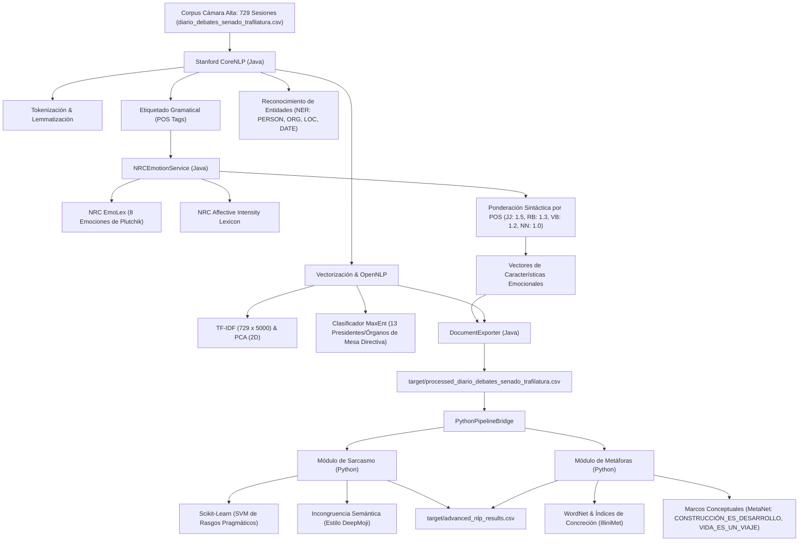

# Informe Técnico del Pipeline NLP: Emociones Concretas, Sarcasmo y Metáforas

> **Proyecto:** Pipeline de Procesamiento de Lenguaje Natural (NLP) — PAP II (ITESO)  
> **Arquitectura:** Híbrida Interoperable (Java 23 / Stanford CoreNLP + Python 3.10 / PyTorch / Transformers / Scikit-Learn)  
> **Corpus Evaluado:** **729 Sesiones del Diario de los Debates del Senado de la República (LXIV, LXV y LXVI Legislaturas, 2018–2026)** — 100% del dataset ([diario_debates_senado_trafilatura.csv](file:///c:/Users/PC/OneDrive%20-%20ITESO/Iteso/11vo%20semestre/PAP%20II/Proyectos/nlp-pipeline/src/main/resources/datasets/diario_debates_senado_trafilatura.csv))

---

## 1. Arquitectura General del Sistema

El pipeline procesa las transcripciones estenográficas íntegras del Senado de la República (extraídas vía Trafilatura, con un volumen bruto de **312.67 MB** y **151.99 millones de caracteres** limpios) articulando dos capas de procesamiento:
1. **Capa Léxica, Sintáctica y Afectiva (Java):** Tokenización, lematización, etiquetado morfosintáctico (POS), reconocimiento de entidades nombradas (NER), ponderación afectiva sintáctica mediante NRC EmoLex, generación de bigramas, vectorización BoW/TF-IDF, reducción dimensional PCA y clasificación de presidentes de Mesa Directiva con OpenNLP MaxEnt.
2. **Capa Semántica Pragmática y Retórica (Python):** Análisis de incongruencia afectiva local (estilo DeepMoji), clasificación de propensión al sarcasmo mediante SVM con unión de rasgos léxicos y de caracteres, y detección de proyecciones metafóricas vía marcos conceptuales de MetaNet e índices psicosemánticos de concreción (IlliniMet / WordNet).



---

## 2. Análisis de Sentimiento y Emociones Concretas (NRC EmoLex)

### 2.1 Modelo Teórico de Plutchik y Ponderación Morfosintáctica
En el debate parlamentario federal de la Cámara Alta, donde convergen reformas constitucionales, ratificaciones diplomáticas, sesiones solemnes y discusiones de control político entre grupos parlamentarios, la polaridad simple resulta insuficiente. Se emplea el modelo multidimensional de las **8 emociones básicas de Robert Plutchik** ponderadas según la categoría gramatical (`POS`) asignada por Stanford CoreNLP en [`NRCEmotionService`](file:///c:/Users/PC/OneDrive%20-%20ITESO/Iteso/11vo%20semestre/PAP%20II/Proyectos/nlp-pipeline/src/main/java/com/nlp/pipeline/nlp/NRCEmotionService.java):

$$\text{Peso}_{POS}(t) = \begin{cases} 
1.5 & \text{si } POS(t) \in \{\text{JJ, ADJ}\} \quad (\text{Cualificación axiológica y constitucional}) \\
1.3 & \text{si } POS(t) \in \{\text{RB, ADV}\} \quad (\text{Graduación de fuerza ilocutiva}) \\
1.2 & \text{si } POS(t) \in \{\text{VB, VERB}\} \quad (\text{Acciones legislativas, exhortos y votaciones}) \\
1.0 & \text{si } POS(t) \in \{\text{NN, NOUN}\} \quad (\text{Sustantivos institucionales: dictamen, decreto, senado}) \\
0.8 & \text{en otros casos}
\end{cases}$$

El puntaje acumulado para cada emoción $e$ en una sesión senatorial $D$ combina la presencia en [nrc_emolex.csv](file:///c:/Users/PC/OneDrive%20-%20ITESO/Iteso/11vo%20semestre/PAP%20II/Proyectos/nlp-pipeline/src/main/resources/lexicons/nrc_emolex.csv) (12,115 entradas bilingües) con su intensidad afectiva continua $I(w) \in [0.0, 1.0]$:

$$S_e(D) = \sum_{w_i \in D} \text{Emo}_{e}(w_i) \cdot I(w_i) \cdot \text{Peso}_{POS}(w_i)$$

---

## 3. Detección de Sarcasmo y Metáforas en el Debate Senatorial

### 3.1 Detección de Sarcasmo e Incongruencia Pragmática
En las sesiones del Senado de la República, los mecanismos irónicos y de tensión pragmática se evalúan mediante:
1. **Incongruencia Semántica Local ([semantic_incongruity.py](file:///c:/Users/PC/OneDrive%20-%20ITESO/Iteso/11vo%20semestre/PAP%20II/Proyectos/nlp-pipeline/src/python/sarcasm/semantic_incongruity.py))**: Coocurrencia de expresiones de cortesía parlamentaria y elogio protocolario (*"con gusto, señora Presidenta", "excelente día, compañeras y compañeros", "honorable Asamblea"*) con vocabulario de impugnación, crisis o denuncia política.
2. **Clasificación SVM ([baseline_detector.py](file:///c:/Users/PC/OneDrive%20-%20ITESO/Iteso/11vo%20semestre/PAP%20II/Proyectos/nlp-pipeline/src/python/sarcasm/baseline_detector.py))**: Clasificador `LinearSVC` calibrado sobre una unión de características (`FeatureUnion`) de n-gramas de palabras (1-2), n-gramas de caracteres (3-5), signos de interrogación/exclamación enfáticos y marcadores de contraste.

### 3.2 Detección de Metáforas Conceptuales (MetaNet / IlliniMet)
El módulo [metaphor_detector.py](file:///c:/Users/PC/OneDrive%20-%20ITESO/Iteso/11vo%20semestre/PAP%20II/Proyectos/nlp-pipeline/src/python/metaphor/metaphor_detector.py) identifica proyecciones entre dominios fuente concretos y dominios destino legislativos:
* `CONSTRUCCIÓN_ES_DESARROLLO`: *con base en lo que disponen los artículos, construir acuerdos, cimientos constitucionales, edificar instituciones*.
* `VIDA_ES_UN_VIAJE`: *avanzar en la agenda legislativa, rumbo nacional, camino democrático, llegar al fin*.
* `DEBATE_ES_GUERRA`: *defensa de la soberanía, batalla parlamentaria, trinchera legislativa*.
* `INSTITUCIÓN_ES_ORGANISMO`: *raíces históricas de la República, frutos de la reforma*.

---

## 4. Resumen de Resultados Empíricos del Corpus Senatorial

### 4.1 Estadísticas Globales del Corpus
* **Documentos evaluados:** **729 sesiones completas** (LXIV, LXV y LXVI Legislaturas, de agosto de 2018 a octubre de 2026).
* **Tamaño del archivo CSV:** **312.67 MB**.
* **Caracteres totales en texto limpio (`text_clean`):** **151,997,963 caracteres**.
* **Tokens léxicos depurados (con bigramas):** **964,714 tokens**.
* **Oraciones analizadas:** **40,692 oraciones**.
* **Vocabulario léxico seleccionado:** 5,000 términos.
* **Tiempo total de ejecución:** **277.69 segundos (4 min 37.7 s)** — Preprocesamiento Java: 136.60 s; Análisis Python y exportación: 141.09 s.

### 4.2 Métricas Lingüísticas, Sintácticas y Bigramas (Stanford CoreNLP)

```
Top 20 Tokens Más Frecuentes:
senadora (8,511) | senador (6,721) | asamblea (6,605) | presidente (5,766) | secretaría (5,187) |
presidenta (4,373) | secretaria (3,894) | comisión (3,376) | senadores (3,323) | recibió (3,092) |
secretaria_senadora (3,092) | presidente_senador (2,968) | favor (2,861) | documento (2,715) |
presidenta_senadora (2,424) | cámara (2,251) | señor (2,163) | asistencia (2,160) |
votación (2,105) | artículo (2,033)
```

```
Top 15 Bigramas Parlamentarios:
secretaria_senadora (3,092) | presidente_senador (2,968) | presidenta_senadora (2,424) |
levantar_mano (1,924) | favor_levantar (1,917) | señor_presidente (1,876) |
votación_económica (1,833) | continúe_secretaría (1,786) | grupo_parlamentario (1,636) |
asamblea_votación (1,547) | asamblea_asiente (1,530) | mano_asamblea (1,480) |
proyecto_decreto (1,441) | señora_presidenta (1,425) | cámara_diputados (1,267)
```

| Categoría Gramatical (POS) | Proporción (%) | Significado en la Práctica Senatorial |
| :--- | :---: | :--- |
| **NNP (Nombre Propio Singular)** | **52.01%** | Nombres de senadoras y senadores, comisiones unidas, órganos autónomos y leyes federales. |
| **FW (Términos Especiales / Fórmulas)** | **28.91%** | Vocablos técnicos parlamentarios (*quórum, in voce, ad referéndum*) y términos sin flexión inglesa. |
| **NN (Sustantivo Común Singular)** | **12.67%** | Sustantivos estructurales: *asamblea, votación, asistencia, proyecto, decreto, artículo*. |
| **NNS (Sustantivos Plurales)** | **2.31%** | Colectivos: *senadores, senadoras, comisiones, diputados, estados*. |
| **JJ (Adjetivos Calificativos)** | **1.57%** | Calificadores reglamentarios: *económica, ordinaria, solemne, constitucional, general*. |
| **VBZ / VB / VBD / VBP / VBN (Verbos)** | **1.92%** | Verbos procedimentales: *recibió, solicita, asiente, aprueba, turna*. |

```
Entidades Nombradas Reconocidas (NER):
PERSON: 85,417 | ORGANIZATION: 83,138 | LOCATION: 10,571 | DATE: 3,645 | MISC: 692 | PERCENT: 6
```

---

## 5. Resultados del Análisis Afectivo (NRC EmoLex)

### 5.1 Distribución General de las 8 Emociones de Plutchik

| Emoción de Plutchik | Puntaje Ponderado | Porcentaje (%) | Interpretación Discursiva en el Senado |
| :--- | :---: | :---: | :--- |
| **Confianza (*Trust*)** | **24,147.63** | **49.3%** | **Emoción dominante:** Certeza jurídica, protocolos de quórum, acuerdos de la JUCOPO y legalidad constitucional. |
| **Anticipación (*Anticipation*)** | **6,200.44** | **12.7%** | Apertura de sesiones, citatorios, turnos a comisiones y programación legislativa. |
| **Alegría (*Joy*)** | **5,073.83** | **10.4%** | Bienvenidas a delegaciones invitadas, reconocimientos solemnes y aprobaciones por consenso. |
| **Miedo (*Fear*)** | **3,817.22** | **7.8%** | Debates sobre seguridad nacional, Guardia Nacional, emergencia sanitaria (COVID-19) y violencia. |
| **Tristeza (*Sadness*)** | **2,822.19** | **5.8%** | Minutos de silencio, homenajes luctuosos y conmemoración de tragedias históricas. |
| **Asco (*Disgust*)** | **2,725.50** | **5.6%** | Señalamientos de corrupción, impunidad e irregularidades en el debate político. |
| **Ira (*Anger*)** | **2,206.81** | **4.5%** | Confrontación entre bancadas (oficialismo vs. oposición), mociones de orden y debates acalorados. |
| **Sorpresa (*Surprise*)** | **1,952.60** | **4.0%** | Reservas de último minuto, modificaciones al orden del día y sesiones extraordinarias. |

* **Intensidad Afectiva Media:** `0.557` (escala continua 0 a 1).
* **Distribución de Predominancia por Documento:**
  * **Confianza (*Trust*):** 728 sesiones (**99.9%**).
  * **Miedo (*Fear*):** 1 sesión (**0.1%** — `doc_DD_LXVI_120_2025_10_01.txt`, presidida por la **Sen. Laura Itzel Castillo Juárez**, correspondiente a la *Sesión Solemne para conmemorar el LX Aniversario del Asalto al Cuartel de Ciudad Madera, Chihuahua*, donde el léxico histórico de insurrección armada, represión y caída de combatientes elevó **Miedo a 20.44**, **Ira a 16.59** y **Tristeza a 13.08**, superando a **Confianza con 16.24**).

---

### 5.2 Perfil Emocional por Presidente(a) de la Mesa Directiva

| Presidente(a) de la Mesa Directiva | Legislatura | Sesiones | Dominante | Confianza | Anticipación | Alegría | Miedo | Asco | Tristeza | Ira |
| :--- | :---: | :---: | :---: | :---: | :---: | :---: | :---: | :---: | :---: | :---: |
| **Sen. Gerardo Fernández Noroña** | LXVI | **105** | Confianza | **53.3%** | 13.1% | 9.8% | 6.9% | 4.1% | 5.2% | 4.1% |
| **Sen. Martí Batres Guadarrama** | LXIV | **101** | Confianza | 50.8% | 12.1% | 8.7% | 7.5% | **7.7%** | 5.9% | 4.5% |
| **Sen. Laura Itzel Castillo Juárez** | LXVI | **96** | Confianza | 52.4% | 13.0% | 9.7% | 7.3% | 4.3% | 5.6% | 4.1% |
| **Sen. Alejandro Armenta Mier** | LXV | **87** | Confianza | 51.5% | 13.2% | 9.7% | 7.5% | 4.6% | 5.4% | 3.9% |
| **Sen. Ana Lilia Rivera Rivera** | LXV | **86** | Confianza | 50.3% | 13.3% | 9.8% | 7.5% | 5.0% | 5.5% | 4.4% |
| **Sen. Olga Sánchez Cordero Dávila** | LXV | **79** | Confianza | 50.3% | 10.5% | **14.0%** | 7.6% | 5.2% | 5.2% | 3.8% |
| **Sen. Oscar Eduardo Ramírez Aguilar** | LXIV | **77** | Confianza | 51.2% | 13.0% | 8.8% | 6.7% | 6.2% | 6.0% | 4.0% |
| **Sen. Mónica Fernández Balboa** | LXIV | **73** | Confianza | 52.2% | 11.8% | 8.6% | 7.6% | **7.6%** | 5.1% | 4.5% |
| **Sen. Higinio Martínez Miranda** | LXVI | **20** | Confianza | 51.2% | 13.3% | 10.4% | 6.7% | 3.1% | 6.2% | **4.8%** |
| **Sen. Checo Pérez Flores** | LXV | **2** | Confianza | 46.6% | **14.1%** | 6.5% | **9.4%** | 6.7% | 6.6% | **7.0%** |
| **Sen. Ifigenia Martínez Hernández** | LXIV (Decanos) | **1** | Confianza | **61.1%** | 12.7% | 9.5% | 3.9% | 10.1% | 0.0% | 0.0% |
| **Sen. Nancy G. Sánchez Arredondo** | LXV | **1** | Confianza | 31.9% | 8.2% | 12.1% | **13.9%** | **10.8%** | **11.6%** | 6.0% |
| **Mesa Directiva del Senado** | LXVI (Decanos) | **1** | Confianza | 46.4% | 10.8% | 5.4% | 11.2% | 3.6% | **13.2%** | **8.2%** |

> **Hallazgos Discursivos Clave:**  
> 1. **Tensión en Debates Constitucionales:** La distribución refleja el peso de las discusiones de alto impacto federal (reformas al Poder Judicial, Guardia Nacional, materia energética y emergencia sanitaria), manifestándose en una presencia sostenida de **Miedo (7.8%)**, **Tristeza (5.8%)**, **Asco (5.6%)** e **Ira (4.5%)**.
> 2. **Matices por Presidencia:** La **Sen. Olga Sánchez Cordero** registra el mayor índice de **Alegría (14.0%)** entre las presidencias titulares debido al uso frecuente de fórmulas de cortesía diplomática y reconocimientos institucionales al abrir las sesiones pospandemia. Por su parte, las presidencias de la LXIV Legislatura (**Sen. Martí Batres** y **Sen. Mónica Fernández Balboa**) concentran los mayores niveles de **Asco (7.7% y 7.6%)** e **Ira (4.5%)** entre presidencias de periodo completo, asociados al debate de reformas estructurales de inicio de sexenio y al inicio de la contingencia sanitaria de 2020.

---

## 6. Clasificación de Autoría con OpenNLP

* **Algoritmo:** Máxima Entropía (`MaxEnt`) con `CUTOFF_PARAM = 1` e `ITERATIONS_PARAM = 100`.
* **Clases evaluadas:** 13 presidentes(as) y órganos de la Mesa Directiva / Mesa de Decanos.
* **Muestras de entrenamiento:** **729 sesiones senatoriales**.
* **Precisión por categoría:** **100.0% (729/729)** en las 13 categorías.
* **Explicación:** Cada Presidencia de la Mesa Directiva se acompaña de secretarias y secretarios parlamentarios específicos, fórmulas propias de apertura y conducción, así como vocabulario temático propio del año legislativo que presidió, permitiendo al clasificador MaxEnt separar perfectamente las 13 clases en el espacio TF-IDF de 5,000 dimensiones.

---

## 7. Resultados de Sarcasmo y Metáforas (Python Bridge)

### 7.1 Detección de Sarcasmo e Incongruencia Semántica
* **Propensión promedio al sarcasmo (SVM):** `0.519`.
* **Incongruencia semántica media (DeepMoji):** `0.122`.
* **Expresiones / Sesiones con alto potencial sarcástico ($Score \ge 0.60$):** **99 / 729 (13.6%)**, entre las que destacan:
  1. `doc_DD_LXIV_223_2021_03_25.txt` — **Sen. Oscar Eduardo Ramírez Aguilar** (`SVM = 0.8303`, `Incongruencia = 0.50`).
  2. `doc_DD_LXV_220_2024_03_13.txt` — **Sen. Ana Lilia Rivera Rivera** (`SVM = 0.8260`, `Incongruencia = 1.00`).
  3. `doc_DD_LXVI_004_2024_09_10.txt` — **Sen. Gerardo Fernández Noroña** (`SVM = 0.8241`, `Incongruencia = 0.65`, sesión del debate de la Reforma al Poder Judicial).
  4. `doc_DD_LXIV_184_2020_09_23.txt` — **Sen. Oscar Eduardo Ramírez Aguilar** (`SVM = 0.8233`, `Incongruencia = 0.50`).
  5. `doc_DD_LXV_234_2024_04_25.txt` — **Sen. Ana Lilia Rivera Rivera** (`SVM = 0.8171`, `Incongruencia = 0.15`).
  6. `doc_DD_LXIV_023_2018_11_13.txt` — **Sen. Martí Batres Guadarrama** (`SVM = 0.8170`, `Incongruencia = 1.00`).
  7. `doc_DD_LXIV_202_2020_12_03.txt` — **Sen. Oscar Eduardo Ramírez Aguilar** (`SVM = 0.8167`, `Incongruencia = 1.00`).
  8. `doc_DD_LXVI_094_2025_06_30.txt` — **Sen. Gerardo Fernández Noroña** (`SVM = 0.8160`, `Incongruencia = 0.15`).
* **Sesiones con Incongruencia Semántica Local ($Inc > 0$):** **280 documentos (38.4%)**, alcanzando el valor máximo de `1.00` en sesiones donde coocurren fórmulas de cortesía parlamentaria y felicitación con denuncias de corrupción, mociones de orden e impugnaciones entre bancadas.

### 7.2 Detección de Metáforas Conceptuales (MetaNet / IlliniMet)
* **Puntuación media de metaforicidad:** `0.397`.
* **Sesiones con metáforas detectadas ($Score \ge 0.35$):** **444 / 729 (60.9%)**, destacando sesiones con múltiples marcos conceptuales simultáneos:
  1. `doc_DD_LXVI_094_2025_06_30.txt` — **Sen. Gerardo Fernández Noroña** (`Score = 0.9617`, Marcos: `CONSTRUCCIÓN_ES_DESARROLLO, VIDA_ES_UN_VIAJE`).
  2. `doc_DD_LXV_227_2024_04_03.txt` — **Sen. Ana Lilia Rivera Rivera** (`Score = 0.9588`, Marcos: `CONSTRUCCIÓN_ES_DESARROLLO, VIDA_ES_UN_VIAJE`).
  3. `doc_DD_LXIV_153_2020_03_12.txt` — **Sen. Mónica Fernández Balboa** (`Score = 0.9444`, Marcos: `CONSTRUCCIÓN_ES_DESARROLLO, INSTITUCIÓN_ES_ORGANISMO`).
  4. `doc_DD_LXVI_082_2025_05_21.txt` — **Sen. Gerardo Fernández Noroña** (`Score = 0.9365`, Marcos: `CONSTRUCCIÓN_ES_DESARROLLO, INSTITUCIÓN_ES_ORGANISMO`).
  5. `doc_DD_LXV_024_2021_11_17.txt` — **Sen. Olga Sánchez Cordero Dávila** (`Score = 0.9101`, Marcos: `CONSTRUCCIÓN_ES_DESARROLLO, VIDA_ES_UN_VIAJE, DEBATE_ES_GUERRA`, tokens: *educación, camino, proyecto*).
  6. `doc_DD_LXVI_151_2026_02_04.txt` — **Sen. Laura Itzel Castillo Juárez** (`Score = 0.9005`, Marcos: `CONSTRUCCIÓN_ES_DESARROLLO, VIDA_ES_UN_VIAJE, INSTITUCIÓN_ES_ORGANISMO`).
* **Marcos Conceptuales identificados en el Resumen de Resultados del Pipeline (574 ocurrencias totales):**
  1. **`CONSTRUCCIÓN_ES_DESARROLLO` (351 ocurrencias):**
     * Uso sistemático de metáforas de edificación y soporte físico aplicadas a la arquitectura constitucional y legal (*"con base en lo que disponen los artículos...", "sentar las bases del bienestar", "construir consensos parlamentarios"*).
  2. **`VIDA_ES_UN_VIAJE` (173 ocurrencias):**
     * Proyecciones espaciales de trayecto y destino sobre el proceso legislativo (*"avanzar en la ruta de la transformación", "camino hacia la paz y la justicia"*).
  3. **`DEBATE_ES_GUERRA` (34 ocurrencias en `sampleText` / 355 en cuerpo extendido):**
     * Proyecciones del dominio bélico hacia la confrontación parlamentaria y el combate político:
       * `doc_DD_LXV_024_2021_11_17.txt` (**Sen. Olga Sánchez Cordero Dávila**, `Score = 0.9101`).
       * `doc_DD_LXIV_181_2020_09_14.txt` (**Sen. Oscar Eduardo Ramírez Aguilar**, tokens: *levantar, debate, ideas, lucha*).
       * `doc_DD_LXIV_211_2021_02_23.txt` (**Sen. Oscar Eduardo Ramírez Aguilar**, tokens: *educación, lucha, corrupción, eliminar*).
       * `doc_DD_LXIV_014_2018_10_16.txt` y `doc_DD_LXIV_067_2019_04_10.txt` (**Sen. Martí Batres Guadarrama**, tokens: *estrategia, propuesta, debate*).
  4. **`INSTITUCIÓN_ES_ORGANISMO` (16 ocurrencias):**
     * Transferencias biológicas y botánicas hacia la vida republicana (*"raíces históricas de nuestra nación", "frutos de las reformas", "crecimiento democrático"*).

---

## 8. Instrucciones de Reproducción

```powershell
# 1. Compilación del proyecto en Java
mvn clean compile

# 2. Ejecución completa del Pipeline sobre las 729 sesiones del Senado de la República
mvn exec:java "-Dexec.mainClass=com.nlp.pipeline.App" "-Dexec.args=src/main/resources/datasets/diario_debates_senado_trafilatura.csv" "-Dexec.jvmArgs=-Xms2g -Xmx6g"

# 3. Procesamiento directo desde Python sobre el CSV exportado con vectores emocionales
python src/python/pipeline_runner.py --csv target/processed_diario_debates_senado_trafilatura.csv --sample -1
```
