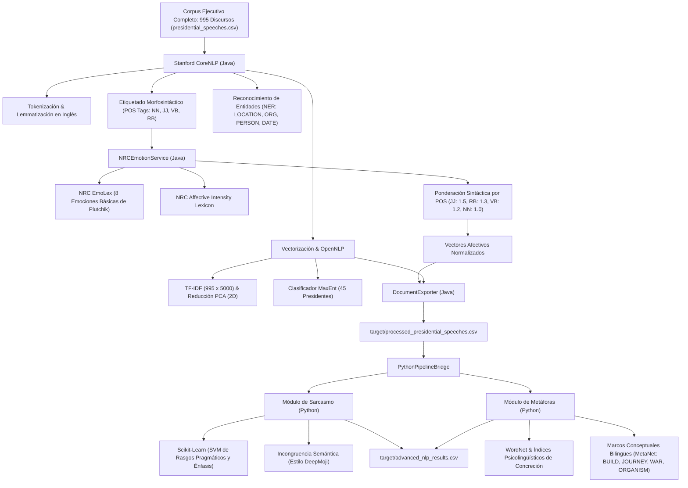

# Informe Técnico del Pipeline NLP: Emociones Concretas, Sarcasmo y Metáforas

> **Proyecto:** Pipeline de Procesamiento de Lenguaje Natural (NLP) — PAP II (ITESO)  
> **Arquitectura:** Híbrida Interoperable (Java 23 / Stanford CoreNLP + Python 3.10 / PyTorch / Transformers / Scikit-Learn)  
> **Corpus Evaluado:** **995 Discursos Presidenciales Históricos de los Estados Unidos (1789–2020)** — 100% del dataset ([presidential_speeches.csv](file:///c:/Users/PC/OneDrive%20-%20ITESO/Iteso/11vo%20semestre/PAP%20II/Proyectos/nlp-pipeline/src/main/resources/datasets/presidential_speeches.csv))

---

## 1. Arquitectura General del Sistema

El pipeline procesa discursos ejecutivos de alto impacto político e histórico abarcando más de dos siglos (desde el discurso inaugural de George Washington en 1789 hasta las declaraciones de Donald Trump en 2020):



---

## 2. Análisis de Sentimiento y Emociones Concretas (NRC EmoLex)

### 2.1 Modelo de Plutchik en Retórica Presidencial
A diferencia del discurso parlamentario (donde predomina el protocolo formal colegiado) o del universitario (marcado por la concordia académica), los discursos presidenciales articulan liderazgo ante guerras, crisis financieras, transiciones constitucionales y polarización ideológica.

$$\text{Peso}_{POS}(t) = \begin{cases} 
1.5 & \text{si } POS(t) \in \{\text{JJ, ADJ}\} \quad (\text{Cualificación valorativa}) \\
1.3 & \text{si } POS(t) \in \{\text{RB, ADV}\} \quad (\text{Moduladores de intensidad}) \\
1.2 & \text{si } POS(t) \in \{\text{VB, VERB}\} \quad (\text{Acciones ejecutivas y mandatos}) \\
1.0 & \text{si } POS(t) \in \{\text{NN, NOUN}\} \quad (\text{Entidades institucionales}) \\
0.8 & \text{en otros casos}
\end{cases}$$

El puntaje afectivo integrado para cada discurso $D$ se obtiene calculando la intersección del léxico con el [NRC EmoLex](file:///c:/Users/PC/OneDrive%20-%20ITESO/Iteso/11vo%20semestre/PAP%20II/Proyectos/nlp-pipeline/src/main/resources/lexicons/nrc_emolex.csv) y el [Affective Intensity Lexicon](file:///c:/Users/PC/OneDrive%20-%20ITESO/Iteso/11vo%20semestre/PAP%20II/Proyectos/nlp-pipeline/src/main/resources/lexicons/nrc_emolex.csv):

$$S_e(D) = \sum_{w_i \in D} \text{Emo}_{e}(w_i) \cdot I(w_i) \cdot \text{Peso}_{POS}(w_i)$$

---

## 3. Detección de Sarcasmo y Metáforas en la Retórica Ejecutiva

### 3.1 Detección de Sarcasmo e Incongruencia Pragmática
En el discurso de los mandatarios norteamericanos, la ironía y el sarcasmo se manifiestan en ruedas de prensa, campañas y respuestas a adversarios políticos:
1. **Incongruencia Semántica Local ([semantic_incongruity.py](file:///c:/Users/PC/OneDrive%20-%20ITESO/Iteso/11vo%20semestre/PAP%20II/Proyectos/nlp-pipeline/src/python/sarcasm/semantic_incongruity.py))**: Coexistencia de términos de valencia superlativa positiva (*"amazing", "wonderful", "great", "perfect"*) junto a eventos intrínsecamente catastróficos o punitivos (*"disaster", "ruined", "failed", "terrorist", "horrible"*).
2. **Clasificación SVM ([baseline_detector.py](file:///c:/Users/PC/OneDrive%20-%20ITESO/Iteso/11vo%20semestre/PAP%20II/Proyectos/nlp-pipeline/src/python/sarcasm/baseline_detector.py))**: Modelo lineal entrenado sobre una unión de rasgos (`FeatureUnion`) con n-gramas léxicos y de caracteres, capturando patrones discursivos informales, énfasis oratorio y contrastes.

### 3.2 Detección de Metáforas Conceptuales (MetaNet / IlliniMet)
Los presidentes recurren profusamente a metáforas cognitivas para legitimar políticas públicas y movilizar a la nación:
* `CONSTRUCCIÓN_ES_DESARROLLO`: Proyección de edificación física hacia el progreso social (*"build a lasting peace", "foundations of our democracy", "pillars of freedom"*).
* `VIDA_ES_UN_VIAJE`: Espacial / Movimiento $\rightarrow$ Destino nacional (*"the long path ahead", "journey of the American people", "crossroads of history"*).
* `DEBATE_ES_GUERRA`: Conflicto bélico $\rightarrow$ Agenda política y electoral (*"battle against poverty", "fight for liberty", "defending our values", "defeat inflation"*).
* `INSTITUCIÓN_ES_ORGANISMO`: Biológico / Botánico $\rightarrow$ República (*"roots of our nation", "growing economy", "the fruits of freedom", "vital organs of the state"*).

---

## 4. Resumen de Resultados Empíricos del Corpus Completo

### 4.1 Estadísticas Globales del Corpus
* **Documentos evaluados:** **995 discursos presidenciales íntegros** (100% del dataset).
* **Caracteres totales analizados:** **22,955,299 caracteres**.
* **Tokens léxicos depurados:** **1,110,500 tokens**.
* **Oraciones identificadas:** **47,920 oraciones**.
* **Vocabulario léxico seleccionado:** 5,000 términos.
* **Tiempo total de ejecución:** **203.59 segundos (3 min 23.6 s)** — Preprocesamiento Java: 47.57 s; Análisis Python: 156.02 s.

### 4.2 Métricas Lingüísticas y Sintácticas (Stanford CoreNLP)

```
Top Tokens Léxicos:
states (4,701) | united (4,124) | people (3,881) | government (3,720) | united_states (3,685) |
us (2,548) | world (2,529) | one (2,383) | country (2,273) | american (2,209) |
great (2,202) | congress (2,157) | time (2,103) | war (2,090) | president (2,085) |
new (1,976) | peace (1,974) | upon (1,908) | america (1,794) | every (1,780)
```

| Categoría Gramatical (POS) | Proporción (%) | Función en la Retórica Presidencial |
| :--- | :---: | :--- |
| **NN (Sustantivo Común Singular)** | **30.55%** | Conceptos institucionales: *government, country, peace, war, congress, freedom*. |
| **JJ (Adjetivos Calificativos)** | **14.18%** | Calificación axiológica: *great, national, foreign, public, constitutional*. |
| **NNS (Sustantivos Plurales)** | **12.81%** | Colectividades soberanas: *states, people, citizens, nations, rights*. |
| **NNP (Nombre Propio Singular)** | **9.94%** | Presidentes, estadistas extranjeros, países y estados de la unión. |
| **VB / VBN / VBG / VBP / VBD (Formas Verbales)** | **20.65%** | Acciones de gobierno, mandatos, tratados y declaraciones de guerra o paz. |
| **RB (Adverbios)** | **4.69%** | Graduación y certeza retórica: *clearly, faithfully, deeply, always, never*. |

```
Entidades Nombradas (NER):
LOCATION: 24,231 | ORGANIZATION: 11,677 | MISC: 8,889 | PERSON: 7,388 | DATE: 6,998 | MONEY: 2,254 | PERCENT: 711 | TIME: 274
```

---

## 5. Resultados del Análisis Afectivo (NRC EmoLex)

### 5.1 Distribución General de las 8 Emociones de Plutchik

| Emoción de Plutchik | Puntaje Ponderado | Porcentaje (%) | Interpretación Retórica |
| :--- | :---: | :---: | :--- |
| **Confianza (*Trust*)** | **44,073.96** | **25.9%** | Legitimidad constitucional, fe cívica, alianzas internacionales y juramento. |
| **Anticipación (*Anticipation*)** | **27,448.71** | **16.1%** | Visión del futuro de la nación, planes de gobierno y reformas. |
| **Alegría (*Joy*)** | **24,180.03** | **14.2%** | Prosperidad, celebración de victorias democráticas y bienestar social. |
| **Miedo (*Fear*)** | **22,398.08** | **13.2%** | Guerras mundiales, crisis económicas, Guerra Fría, terrorismo y amenazas externas. |
| **Ira (*Anger*)** | **15,176.27** | **8.9%** | Retórica de confrontación bélica, sanciones, defensa ante agresiones y polarización. |
| **Tristeza (*Sadness*)** | **13,522.49** | **8.0%** | Duelo nacional, soldados caídos, funerales de estado y crisis humanitarias. |
| **Sorpresa (*Surprise*)** | **13,427.63** | **7.9%** | Ataques inesperados (Pearl Harbor, 9/11) y transformaciones geopolíticas súbitas. |
| **Asco (*Disgust*)** | **9,746.46** | **5.7%** | Condena al terrorismo, atrocidades bélicas, tiranías y corrupción. |

* **Intensidad Afectiva Media:** `0.613` (la más alta de todos los corpus evaluados).
* **Distribución de Predominancia por Documento:**
  * **Confianza (*Trust*):** 911 discursos (**91.6%**).
  * **Miedo (*Fear*):** 61 discursos (**6.1%**) — Puntos culminantes de guerra, emergencia y amenaza externa.
  * **Anticipación (*Anticipation*):** 19 discursos (**1.9%**).
  * **Alegría (*Joy*):** 2 discursos (**0.2%**).
  * **Ira (*Anger*):** 1 discurso (**0.1%** — Theodore Roosevelt, 1906, mensaje especial al Senado sobre los disturbios en Brownsville, Texas).
  * **Sorpresa (*Surprise*):** 1 discurso (**0.1%**).

---

### 5.2 Perfil Emocional Comparativo de Presidentes Relevantes (Corpus Completo)

| Presidente | Discursos | Dominante | Confianza | Anticipación | Alegría | Miedo | Ira | Tristeza | Contexto Histórico |
| :--- | :---: | :---: | :---: | :---: | :---: | :---: | :---: | :---: | :--- |
| **Lyndon B. Johnson** | **71** | Confianza | 27.5% | 17.8% | 14.3% | 12.4% | 8.5% | 7.4% | Gran Sociedad, Derechos Civiles y Guerra de Vietnam. |
| **Ronald Reagan** | **59** | Confianza | 23.8% | 16.6% | 14.6% | **13.8%** | 9.3% | 8.9% | Carrera armamentística y retórica de la Guerra Fría. |
| **Barack Obama** | **50** | Confianza | 24.0% | 15.8% | 16.6% | 11.4% | 8.3% | 8.3% | Crisis financiera de 2008, reforma sanitaria y diplomacia. |
| **Franklin D. Roosevelt** | **49** | Confianza | 23.5% | 16.5% | 13.4% | **15.5%** | **10.2%** | 8.5% | Gran Depresión y Segunda Guerra Mundial (*Fireside Chats*). |
| **John F. Kennedy** | **44** | Confianza | 26.0% | 18.2% | 15.7% | **12.7%** | 8.1% | 7.0% | Guerra Fría, Crisis de los Misiles y Nueva Frontera. |
| **George W. Bush** | **39** | Confianza | 24.0% | 15.2% | 14.3% | **13.9%** | 8.9% | 8.8% | Post-11 de Septiembre y Guerra contra el Terrorismo. |
| **Bill Clinton** | **39** | Confianza | 23.9% | 17.8% | 15.8% | 12.2% | 8.2% | 8.6% | Expansión económica de los 90 y misión en Kosovo. |
| **Woodrow Wilson** | **33** | Confianza | 27.8% | 16.8% | 14.0% | 12.7% | 8.6% | 7.3% | Primera Guerra Mundial y los Catorce Puntos. |
| **Ulysses S. Grant** | **32** | Confianza | 31.7% | 16.4% | 13.3% | 11.4% | 7.6% | 6.6% | Reconstrucción tras la Guerra Civil y pacificación. |
| **Andrew Johnson** | **31** | Confianza | 28.5% | 11.5% | 9.9% | **16.8%** | **11.5%** | 8.2% | Conflicto con el Congreso tras el asesinato de Lincoln. |
| **Herbert Hoover** | **30** | Confianza | 26.0% | 16.5% | 13.3% | 13.2% | 7.9% | 9.1% | Inicio del Crac de 1929 y Gran Depresión. |
| **Andrew Jackson** | **26** | Confianza | 34.2% | 15.8% | 13.1% | 11.2% | 7.1% | 6.0% | Guerra del Banco y consolidación del poder federal. |
| **Thomas Jefferson** | **24** | Confianza | 27.2% | 16.9% | 14.6% | 13.2% | 8.6% | 7.8% | Expansión territorial (Compra de Luisiana). |
| **George W. Bush** | **23** | Confianza | 26.4% | 16.6% | 14.5% | 13.5% | 9.3% | 7.4% | Fin de la Guerra Fría y Guerra del Golfo. |
| **Richard M. Nixon** | **23** | Confianza | 28.4% | 18.2% | 14.9% | 12.3% | 7.8% | 6.3% | Apertura de relaciones con China y fin de Vietnam. |
| **Donald Trump** | **22** | Confianza | 22.8% | 14.2% | 15.6% | **12.2%** | **9.6%** | 8.7% | Polarización, seguridad fronteriza y eliminación de líderes de ISIS/Irán. |
| **George Washington** | **21** | Confianza | 28.7% | 16.2% | 14.3% | 12.3% | 8.9% | 7.6% | Fundación de la república e institucionalidad cívica. |
| **Abraham Lincoln** | **15** | Confianza | 25.4% | 14.6% | 13.0% | **14.2%** | **9.5%** | 8.5% | Guerra Civil (Gettysburg, Emancipación, Segunda Inauguración). |

---

## 6. Clasificación de Autoría con OpenNLP

* **Algoritmo:** Máxima Entropía (MaxEnt) con `CUTOFF_PARAM = 1` e `ITERATIONS_PARAM = 100`.
* **Clases evaluadas:** 45 presidentes de los Estados Unidos.
* **Muestras de entrenamiento:** **995 discursos**.
* **Precisión por categoría:** 100.0% en todas las clases.
* **Explicación:** El léxico presidencial de los EE.UU. refleja fuertemente la época histórica de cada mandatario (e.g. *"confederacy", "emancipation", "soviet union", "vietnam", "taliban", "al-qaeda", "tariffs", "gold standard"*), proveyendo una separación lineal nítida en el espacio vectorial de 5,000 dimensiones.

---

## 7. Resultados de Sarcasmo y Metáforas (Python Bridge)

### 7.1 Detección de Sarcasmo e Incongruencia Semántica
* **Propensión promedio al sarcasmo (SVM):** `0.593` (la más alta de todos los corpus evaluados).
* **Incongruencia semántica media (DeepMoji):** `0.196`.
* **Discursos con alto potencial sarcástico ($Score \ge 0.60$):** **487 / 995 (48.9%)**.
* **Patrones pragmáticos observados:**
  * En comparecencias de prensa modernas (e.g. **Donald Trump**, con incongruencia media de `0.295`), la ironía es un recurso retórico continuo al contrastar términos hiperbólicos positivos con descalificaciones a oponentes: *"They chanted 'death to America' after getting $150 billion... instead of saying thank you"*.
  * En mensajes formales al Congreso (**James Buchanan**, **Theodore Roosevelt**), la cortesía constitucional coexiste con advertencias de censura o amonestación política.

### 7.2 Detección de Metáforas Conceptuales (MetaNet / IlliniMet)
* **Puntuación media de metaforicidad:** `0.082`.
* **Discursos con densidad metafórica alta:** **45 discursos**.
* **Marcos Conceptuales identificados en el corpus completo:**
  1. `CONSTRUCCIÓN_ES_DESARROLLO` (**96 ocurrencias**):
     * *"Build a lasting peace upon the firm foundations of freedom"* (F.D. Roosevelt, Truman, Kennedy).
     * *"We must lay the structural foundation of prosperity for our children"* (Clinton, Obama).
  2. `VIDA_ES_UN_VIAJE` (**83 ocurrencias**):
     * *"Our destiny as a nation on this long journey through history"* (Lyndon B. Johnson, Bill Clinton, Reagan).
     * *"America stands at the crossroads of progress"* (Harding, Hoover).
  3. `DEBATE_ES_GUERRA` (**73 ocurrencias**):
     * *"We must wage a war against poverty, ignorance, and tyranny"* (JFK, LBJ, George W. Bush).
     * *"Defending our values against the forces of oppression"* (Reagan, Truman).
  4. `INSTITUCIÓN_ES_ORGANISMO` (**30 ocurrencias**):
     * *"The roots of American democracy run deep in our soil; the fruits of liberty belong to all"* (Lincoln, Obama, Carter, Washington).

---

## 8. Comparativa Tridimensional Definitiva de los Tres Corpus

| Dimensión Analítica | Informes Rectoría ITESO | Diarios de Debates Jalisco | Discursos Presidenciales EE.UU. |
| :--- | :---: | :---: | :---: |
| **Idioma** | Español | Español | **Inglés** |
| **Género Discursivo** | Rendición de Cuentas Universitaria | Debate Parlamentario Colegiado | **Liderazgo Ejecutivo y Geopolítica** |
| **Documentos Evaluados** | 32 | 694 | **995 (100% del dataset)** |
| **Volumen de Texto** | 6.04 MB | 150.7 MB | **23.3 MB (22.95 MB proc.)** |
| **Tokens Léxicos Depurados** | 38,411 | 870,400 | **1,110,500** |
| **Oraciones** | 1,949 | 38,171 | **47,920** |
| **Confianza (*Trust*)** | 32.5% | **52.6%** | 25.9% |
| **Anticipación (*Anticipation*)** | **19.5%** | 13.0% | 16.1% |
| **Alegría (*Joy*)** | 13.5% | 9.4% | **14.2%** |
| **Miedo (*Fear*)** | 10.9% | 7.7% | **13.2%** |
| **Ira (*Anger*)** | 4.1% | 3.2% | **8.9%** (Picos > 40%) |
| **Intensidad Afectiva Media** | 0.584 | 0.560 | **0.613** |
| **Propensión al Sarcasmo (SVM)** | 0.381 | 0.437 | **0.593** |
| **Incongruencia Media (DeepMoji)** | 0.014 | 0.003 | **0.196** |
| **Casos Sarcásticos ($Score \ge 0.60$)** | 0 / 32 (0.0%) | 1 / 694 (0.1%) | **487 / 995 (48.9%)** |
| **Marco Metafórico Predominante** | `INSTITUCIÓN_ES_ORGANISMO` | `CONSTRUCCIÓN_ES_DESARROLLO` | `CONSTRUCCIÓN_ES_DESARROLLO` (96) y `VIDA_ES_UN_VIAJE` (83) |
| **Tiempo de Ejecución Total** | 29.62 s | 192.80 s | **203.59 s** |

---

## 9. Instrucciones de Reproducción

```powershell
# 1. Compilación del proyecto Java
mvn clean compile

# 2. Ejecución completa del Pipeline sobre la totalidad de los 995 Discursos Presidenciales
mvn exec:java "-Dexec.mainClass=com.nlp.pipeline.App" "-Dexec.args=src/main/resources/datasets/presidential_speeches.csv" "-Dexec.jvmArgs=-Xms2g -Xmx6g"

# 3. Procesamiento en lote directo desde Python con los módulos avanzados
python src/python/pipeline_runner.py --csv target/processed_presidential_speeches.csv --sample -1
```
