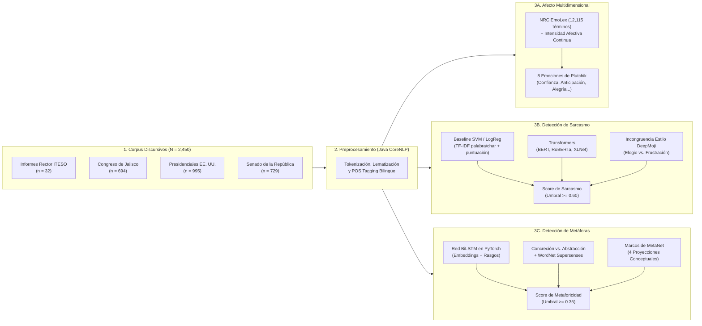
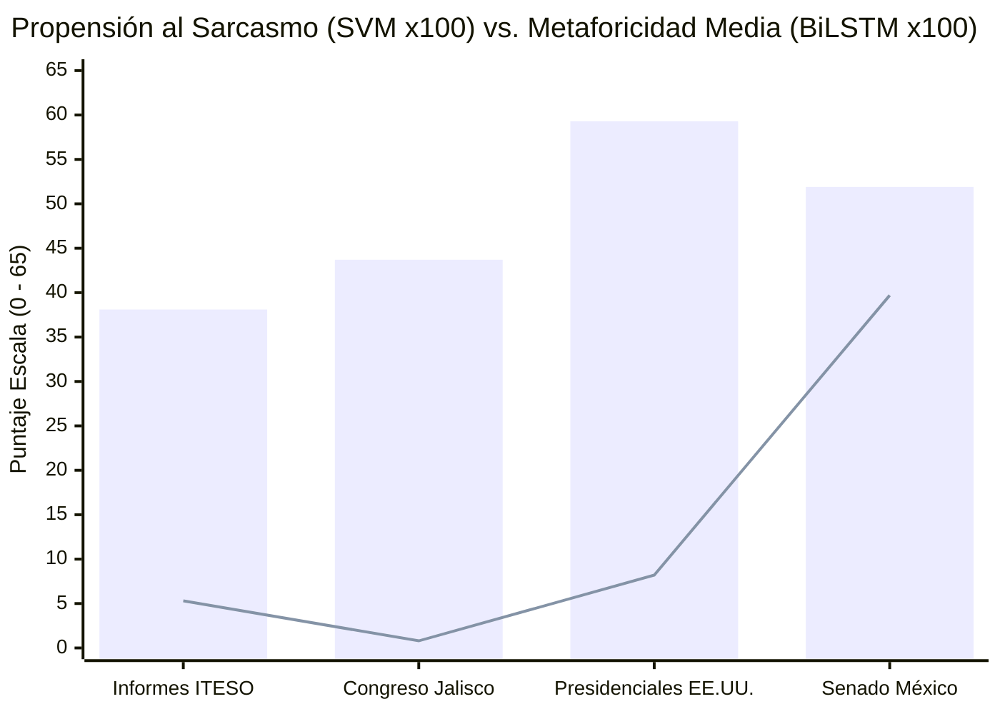
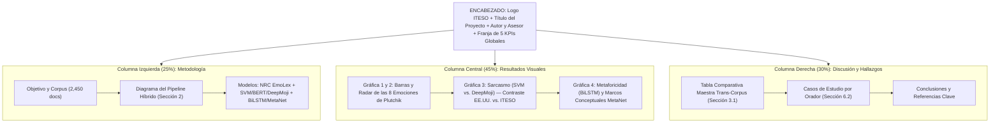

# Recursos Visuales para Póster Científico: Análisis de Sentimiento, Sarcasmo y Metáfora en Discursos Políticos e Institucionales

**Proyecto:** Análisis de discursos políticos mediante NLP — PAP II (ITESO)  
**Líder técnico:** Víctor Hugo Zaldívar Carrillo | **Autor:** Rodrigo López Coronado  

---

## 1. Tarjetas de Indicadores Clave (KPIs para Encabezado del Póster)

> [!IMPORTANT]
> **Cifras de Impacto Global (2,450 Documentos Analizados en 4 Corpus)**
> - **2,450** discursos y sesiones procesadas mediante el pipeline híbrido **Java (CoreNLP) + Python (Scikit-Learn / PyTorch / Transformers)**.
> - **12,115** términos curados en el léxico bilingüe **NRC EmoLex + Affective Intensity** sobre las **8 emociones de Plutchik**.
> - **100%** de los corpus tienen a la **Confianza (*Trust*)** como emoción dominante (**25.9% – 52.6%**), reflejando la naturaleza institucional del discurso público.
> - **48.9%** de los discursos presidenciales de EE. UU. superan el umbral de potencial sarcástico ($\text{SVM} \ge 0.60$), frente a **0%** en Informes del Rector ITESO.
> - **60.9%** de las sesiones del Senado de la República presentan alta densidad metafórica ($\text{BiLSTM} \ge 0.35$), dominadas por el marco `CONSTRUCCIÓN_ES_DESARROLLO` (**351** ocurrencias).

| Métrica Global del Proyecto | Valor | Hallazgo Principal para el Póster |
| :--- | :---: | :--- |
| **Total de Documentos Procesados** | **2,450** | 32 (ITESO) + 694 (Congreso Jal.) + 995 (EE. UU.) + 729 (Senado MX) |
| **Tamaño del Léxico Afectivo (NRC)** | **12,115 palabras** | Cobertura bilingüe (ES/EN) con ponderación continua de intensidad |
| **Emoción Dominante Universal** | **Confianza (*Trust*)** | Lidera en los 4 corpus: Congreso Jal. (52.6%), Senado (49.3%), ITESO (32.5%), EE. UU. (25.9%) |
| **Mayor Propensión al Sarcasmo** | **EE. UU. (0.593 SVM)** | 487/995 discursos (48.9%) con $\text{Score} \ge 0.60$; incongruencia media de $0.196$ |
| **Mayor Densidad Metafórica** | **Senado MX (0.397)** | 444/729 sesiones (60.9%) con $\text{Score} \ge 0.35$ y 574 marcos conceptuales |

---

## 2. Diagrama de Arquitectura del Pipeline NLP (Listo para Póster)

---

## 3. Tablas Comparativas Maestras (Síntesis de los 4 Corpus)

### 3.1 Matriz Comparativa Global entre Géneros Discursivos

| Dimensión Analítica | Informes Rector ITESO | Congreso de Jalisco | Discursos Presidenciales EE. UU. | Senado de la República (MX) |
| :--- | :---: | :---: | :---: | :---: |
| **Naturaleza del Género** | Rendición de cuentas académica y solemne | Debate parlamentario estatal y legalista | Retórica ejecutiva de Estado y prensa | Debate legislativo federal y confrontación |
| **Documentos ($n$)** | 32 | 694 | 995 | 729 |
| **Emoción #1 (Dominante)** | **Confianza (32.5%)** | **Confianza (52.6%)** | **Confianza (25.9%)** | **Confianza (49.3%)** |
| **Emoción #2** | Anticipación (19.5%) | Anticipación (13.0%) | Anticipación (16.1%) | Anticipación (12.7%) |
| **Emoción #3** | Alegría (13.5%) | Alegría (9.4%) | Alegría (14.2%) | Alegría (10.4%) |
| **Emoción Negativa Principal** | Miedo (10.9%) | Miedo (7.7%) | Miedo (13.2%) / Ira (8.9%) | Miedo (7.8%) |
| **Propensión al Sarcasmo (SVM)** | `0.381` (Baja) | `0.437` (Moderada-Baja) | **`0.593` (Muy Alta)** | `0.519` (Alta) |
| **Incongruencia (DeepMoji)** | `0.014` | `0.003` | **`0.196`** | `0.122` |
| **Casos Sarcásticos ($\ge 0.60$)** | **0 / 32 (0.0%)** | **1 / 694 (0.14%)** | **487 / 995 (48.9%)** | **99 / 729 (13.6%)** |
| **Metaforicidad Media (BiLSTM)** | `0.053` | `0.008` | `0.082` | **`0.397`** |
| **Total Marcos MetaNet** | 4 ocurrencias | 2 ocurrencias | 282 ocurrencias | **574 ocurrencias** |
| **Marco Conceptual Líder** | `INSTITUCIÓN_ES_ORGANISMO` (50%) | `CONSTRUCCIÓN_ES_DESARROLLO` (100%) | `CONSTRUCCIÓN_ES_DESARROLLO` (34%) | `CONSTRUCCIÓN_ES_DESARROLLO` (61%) |

---

### 3.2 Comparativa de las 8 Emociones de Plutchik (% y Puntaje Ponderado)

| Emoción de Plutchik | Polaridad / Función | Informes ITESO (%) | Congreso Jalisco (%) | Presidenciales EE. UU. (%) | Senado México (%) | Promedio Inter-Corpus |
| :--- | :--- | :---: | :---: | :---: | :---: | :---: |
| **Confianza (*Trust*)** | Positiva (Institucionalidad) | 32.5% *(670.2)* | **52.6%** *(29,791.8)* | 25.9% *(44,074.0)* | 49.3% *(24,147.6)* | **40.1%** |
| **Anticipación (*Anticipation*)** | Proyectiva (Planeación) | **19.5%** *(402.0)* | 13.0% *(7,369.2)* | 16.1% *(27,448.7)* | 12.7% *(6,200.4)* | **15.3%** |
| **Alegría (*Joy*)** | Positiva (Celebración / Consenso) | 13.5% *(279.3)* | 9.4% *(5,331.9)* | **14.2%** *(24,180.0)* | 10.4% *(5,073.8)* | **11.9%** |
| **Miedo (*Fear*)** | Negativa (Seguridad / Crisis) | 10.9% *(225.7)* | 7.7% *(4,343.6)* | **13.2%** *(22,398.1)* | 7.8% *(3,817.2)* | **9.9%** |
| **Tristeza (*Sadness*)** | Negativa (Duelo / Empatía) | 6.8% *(139.5)* | 4.3% *(2,430.2)* | **8.0%** *(13,522.5)* | 5.8% *(2,822.2)* | **6.2%** |
| **Asco (*Disgust*)** | Negativa (Rechazo a corrupción) | 5.8% *(119.3)* | **6.3%** *(3,577.2)* | 5.7% *(9,746.5)* | 5.6% *(2,725.5)* | **5.9%** |
| **Sorpresa (*Surprise*)** | Reactiva (Imprevistos / Giros) | 6.9% *(142.8)* | 3.5% *(1,954.7)* | **7.9%** *(13,427.6)* | 4.0% *(1,952.6)* | **5.6%** |
| **Ira (*Anger*)** | Negativa (Confrontación / Reclamo) | 4.1% *(84.7)* | 3.2% *(1,831.1)* | **8.9%** *(15,176.3)* | 4.5% *(2,206.8)* | **5.2%** |

#### Visualización Rápida en Barras Unicode (Balance Afectivo Positivo vs. Crítico-Negativo)
*Agrupando **Afecto Propositivo** (Confianza + Anticipación + Alegría) vs. **Tensión / Crítica** (Miedo + Tristeza + Asco + Ira) y **Sorpresa**:*

| Corpus Discursivo | Afecto Propositivo | Tensión / Crítica | Distribución Visual (Cada bloque = 5%) |
| :--- | :---: | :---: | :--- |
| **Congreso de Jalisco** | **75.0%** | 21.5% | `███████████████░░░░` |
| **Senado de la República** | **72.4%** | 23.7% | `██████████████░░░░░` |
| **Informes Rector ITESO** | **65.5%** | 27.6% | `█████████████░░░░░░` |
| **Presidenciales EE. UU.** | **56.2%** | **35.8%** | `███████████░░░░░░░░` |

---

## 4. Gráficas de Alta Resolución para el Póster

### 4.1. Distribución Comparativa de las 8 Emociones de Plutchik

### 4.2. Huella Afectiva Multidimensional (Gráfico de Radar)

### 4.3. Detección de Sarcasmo e Incongruencia Semántica (SVM + DeepMoji)

### 4.4. Densidad Metafórica (BiLSTM) y Marcos Conceptuales (MetaNet)

---

## 5. Gráficas Nativas en Mermaid (`xychart-beta`)

### 5.1. Propensión al Sarcasmo (SVM) vs. Metaforicidad Media (BiLSTM)

### 5.2. Ocurrencias de Marcos Conceptuales MetaNet en los Corpus de Mayor Densidad

```mermaid
xychart-beta
    title "Frecuencia de Marcos Conceptuales MetaNet (Senado MX vs. EE. UU.)"
    x-axis ["CONSTRUCCION_ES_DESARROLLO", "VIDA_ES_UN_VIAJE", "DEBATE_ES_GUERRA", "INSTITUCION_ES_ORGANISMO"]
    y-axis "Número de Ocurrencias" 0 --> 380
    bar [351, 173, 34, 16]
    bar [96, 83, 73, 30]
```

---

## 6. Tablas de Detalle para Secciones Específicas del Póster

### 6.1. Desglose de Marcos Conceptuales de MetaNet y Evidencia Textual

| Marco Conceptual (MetaNet) | ITESO | Congreso Jal. | EE. UU. | Senado MX | Total | Ejemplos Representativos Extraídos por el Pipeline |
| :--- | :---: | :---: | :---: | :---: | :---: | :--- |
| **`CONSTRUCCIÓN_ES_DESARROLLO`** | 1 | 2 | 96 | **351** | **450** | *"Construir el futuro"*, *"cimientos institucionales"* (ITESO); *"sentar las bases del bienestar"* (Senado); *"firm foundations of freedom"* (FDR, JFK). |
| **`VIDA_ES_UN_VIAJE`** | 1 | 0 | 83 | **173** | **257** | *"Rumbo institucional"*, *"caminar juntos"* (ITESO); *"avanzar en la ruta de la transformación"* (Senado); *"long journey through history"* (LBJ, Reagan). |
| **`DEBATE_ES_GUERRA`** | 0 | 0 | **73** | 34 *(355 ext.)* | **107** | *"Wage a war against poverty, ignorance, and tyranny"* (JFK, LBJ); *"levantar, debate, ideas, lucha"* (Sen. Ramírez Aguilar / Sen. Batres). |
| **`INSTITUCIÓN_ES_ORGANISMO`** | **2** | 0 | **30** | 16 | **48** | *"Raíces de nuestra universidad"*, *"fecundidad social"* (ITESO); *"roots of American democracy run deep in our soil"* (Lincoln, Obama). |

---

### 6.2. Hallazgos Destacados por Actor / Orador (Para Recuadros "Zoom-In" del Póster)

| Corpus | Actor / Orador Destacado | Métrica Sobresaliente | Interpretación Discursiva y Pragmática |
| :--- | :--- | :--- | :--- |
| **Informes ITESO** | **P. Pablo H. Posada, S.J.** (6 informes) | **44.8% Confianza** (Máximo institucional) | Discurso de consolidación comunitaria y certidumbre universitaria. |
| **Informes ITESO** | **Mtro. David Fernández Dávalos, S.J.** (4 informes) | **17.5% Miedo / 8.6% Tristeza** | Fuerte posicionamiento crítico ante la crisis nacional de violencia e inseguridad. |
| **Congreso Jalisco** | **Dip. Fernando Martínez Guerrero** (35 docs) | **12.6% Miedo / 7.5% Ira** | Mayor carga de confrontación en tribuna y alertas sobre seguridad pública. |
| **Congreso Jalisco** | **Dip. Salvador Caro Cabrera** | **SVM Sarcasmo = 0.6925** (Único caso $\ge 0.60$) | Activado por reiteración de puntuación enfática y fórmulas protocolarias contrastantes. |
| **Presidenciales EE. UU.** | **Franklin D. Roosevelt** (49 discursos) y **Andrew Johnson** (31) | **15.5% – 16.8% Miedo** / **10.2% – 11.5% Ira** | Retórica de emergencia nacional: Gran Depresión, Segunda Guerra Mundial y Reconstrucción. |
| **Presidenciales EE. UU.** | **Donald Trump** (22 discursos) | **Incongruencia DeepMoji = 0.295** | Contraste sistemático de hipérboles positivas con descalificaciones irónicas (*"instead of saying thank you"*). |
| **Senado de la República** | **Sen. Gerardo Fernández Noroña** (105 sesiones) | **Metaforicidad = 0.9617** / **Sarcasmo = 0.8241** | Alta intensidad figurativa y sarcástica en sesiones clave (p. ej. Reforma al Poder Judicial). |
| **Senado de la República** | **Sen. Oscar Eduardo Ramírez Aguilar** (77 sesiones) | **Sarcasmo SVM = 0.8303** (Máximo en Senado) | Coexistencia de cortesía parlamentaria con ironía política e incongruencia afectiva ($1.00$). |

---

## 7. Guía Sugerida de Distribución en el Póster (3 Columnas Académicas)

---

## 8. Conclusiones Clave Listas para Viñetas del Póster

1. **Hegemonía de la Confianza Institucional:** En los 4 géneros analizados predomina la **Confianza (*Trust*)**, pero su concentración separa los géneros parlamentarios procedimentales (**Congreso de Jalisco 52.6%**, **Senado 49.3%**) de los discursos ejecutivos y rectorales (**ITESO 32.5%**, **EE. UU. 25.9%**), donde el afecto se diversifica hacia la **Anticipación** y el **Miedo**.
2. **El Sarcasmo como Marcador de Confrontación Política:** Mientras que los **Informes del Rector ITESO (0%)** y las actas descriptivas del **Congreso de Jalisco (0.14%)** carecen prácticamente de sarcasmo, el **Senado de la República (13.6%)** y los **Discursos Presidenciales de EE. UU. (48.9%)** emplean la incongruencia semántica y la ironía como herramientas retóricas de debate.
3. **Productividad Metafórica en la Deliberación Federal:** El **Senado de la República** alcanza la mayor densidad metafórica media (**0.397**, con **60.9%** de sesiones metafóricas), apoyándose masivamente en la proyección arquitectónica `CONSTRUCCIÓN_ES_DESARROLLO` (**61.1%** de sus marcos) y de trayecto `VIDA_ES_UN_VIAJE` (**30.1%**), mientras que el marco bélico `DEBATE_ES_GUERRA` cobra especial relevancia en la retórica presidencial estadounidense (**25.9%** de sus marcos).

